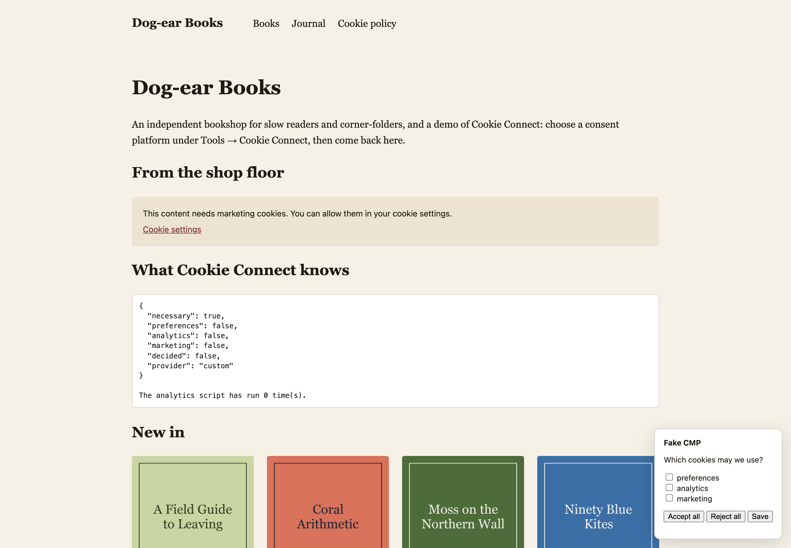
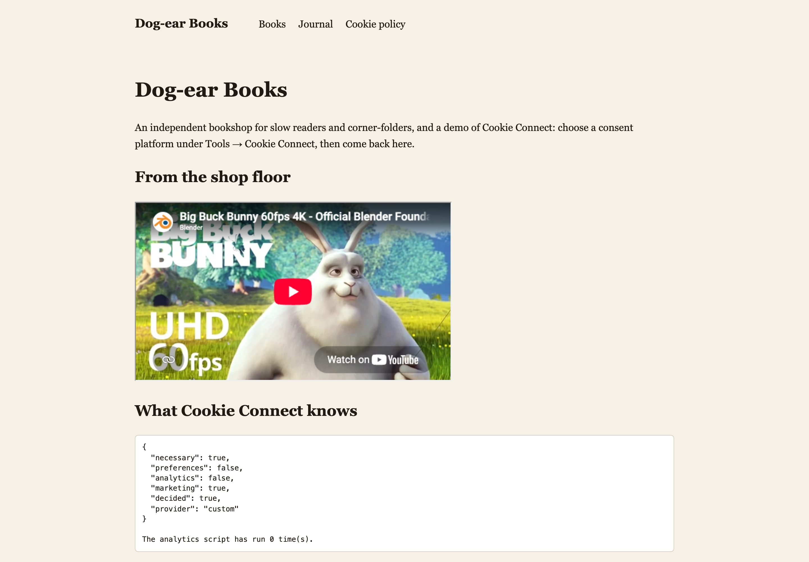
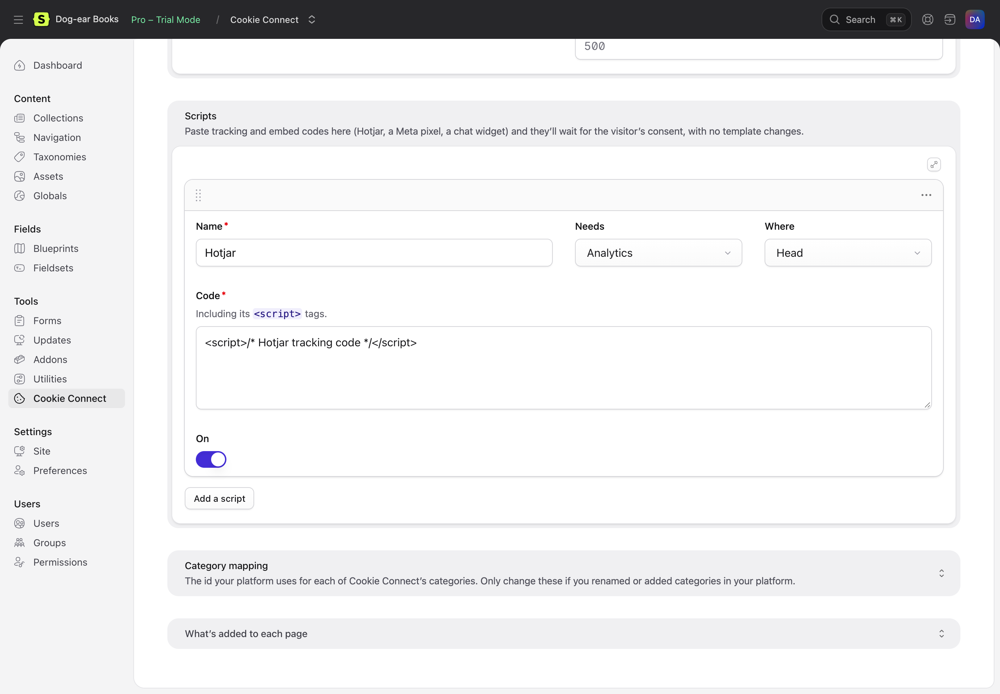

# Holding back scripts and embeds

Wrap anything that sets cookies in the consent tag with the category it needs. It's printed with your platform's own blocking markup, so the platform runs it once the visitor allows that category. Switch platform and the markup changes with it; your templates don't.

```antlers
{{ consent:analytics }}
    <script src="https://plausible.io/js/script.js" defer></script>
{{ /consent:analytics }}

{{ consent:marketing }}
    <iframe src="https://www.youtube.com/embed/abc123" width="560" height="315" allowfullscreen></iframe>
{{ /consent:marketing }}
```

<details>
<summary>Blade</summary>

```blade
<s:consent:analytics>
    <script src="https://plausible.io/js/script.js" defer></script>
</s:consent:analytics>

@consent('marketing')
    <iframe src="https://www.youtube.com/embed/abc123" width="560" height="315" allowfullscreen></iframe>
@endconsent
```

</details>

The categories are **necessary**, **preferences**, **analytics** and **marketing**. Content that needs several categories waits for all of them:

```antlers
{{ consent categories="analytics|marketing" }}…{{ /consent }}
```

<details>
<summary>Blade</summary>

```blade
@consent(['analytics', 'marketing'])…@endconsent
```

</details>

Scripts (inline or with a `src`), iframes and images are held back. Everything else inside the tag (text, `<div>`s, JSON-LD) is printed as it is.

## What it prints

The same template, with two platforms:

```html
<!-- Cookiebot -->
<script type="text/plain" data-cookieconsent="statistics" data-cookie-connect-native="analytics" src="https://plausible.io/js/script.js" defer></script>

<!-- OneTrust -->
<script type="text/plain" class="optanon-category-C0002" data-cookie-connect-native="analytics" src="https://plausible.io/js/script.js" defer></script>
```

Where a platform has no markup for something (CookieYes and inline scripts, Usercentrics, Custom, module scripts, or several categories on a platform that takes one), Cookie Connect holds it back itself (`type="text/plain" data-cookie-connect="analytics"`) and runs it once the platform says yes. Either way, each element is run once, in page order.

## A placeholder





Show a message in place of a held-back embed, with a button that opens the cookie settings:

```antlers
{{ consent:marketing placeholder="true" }}
    <iframe src="https://www.youtube.com/embed/abc123"></iframe>
{{ /consent:marketing }}

{{ consent:marketing placeholder="Allow marketing cookies to watch this video." }}…{{ /consent:marketing }}
```

<details>
<summary>Blade</summary>

```blade
<s:consent:marketing placeholder="true">
    <iframe src="https://www.youtube.com/embed/abc123"></iframe>
</s:consent:marketing>

@consent('marketing', 'Allow marketing cookies to watch this video.')…@endconsent
```

</details>

It's hidden once the category is allowed. Style it with `.cookie-connect-placeholder`. Held-back iframes and images take no space until they're allowed.

On its own:

```antlers
{{ consent:placeholder category="marketing" }}
{{ consent:placeholder category="marketing" text="This video needs marketing cookies." button="Change my cookie settings" }}
```

<details>
<summary>Blade</summary>

```blade
<s:consent:placeholder category="marketing" />
```

</details>

## The modifier

For HTML in a field you trust (an embed code field, say). Like Antlers itself, it prints the value as HTML, so don't use it on anything a visitor can set:

```antlers
{{ embed_code | consent:marketing }}
{{ embed_code | consent:analytics:marketing }}
```

<details>
<summary>Blade</summary>

```blade
{!! Statamic::modify($embed_code)->consent(['marketing']) !!}
```

</details>

## Scripts pasted into the Control Panel

Under **Scripts** on the Cookie Connect page, add a script with:




- a **name**, so you can find it again;
- what it **needs**: necessary, preferences, analytics or marketing;
- **where** it goes: the head, the start of the body or the end of the body;
- its **code**, including the `<script>` tags.

It's printed on every page of that site, held back like content in the consent tag. Turn it off with **On** without deleting it. No template changes.

## When the platform isn't loaded

Where Cookie Connect is off (an environment it doesn't run in, or no platform chosen), consent-gated content is kept blocked, run as if accepted, or left out, as chosen under **Tools → Addons → Cookie Connect → Settings → Elsewhere**. Necessary content is always printed.
